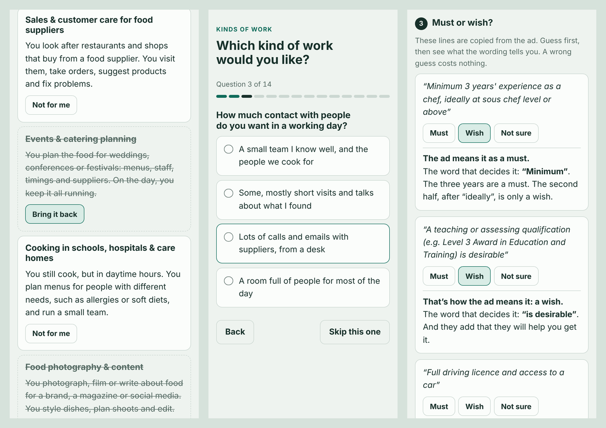

# Job Compass

A Claude skill for the time before the job search: when you don't know yet which kind of work you want, and job ads make it worse.

**See how it works and try the example pages:** [maaasyd.github.io/job-compass](https://maaasyd.github.io/job-compass/)



## Why I built this

Most job tools start once you already know what you want. They help with your CV, find matching ads or prepare you for interviews. But a lot of people get stuck before that.

Say you've just finished university. You open a job site, type in your subject and get 300 results. Half the job titles don't tell you what the job is, and every ad lists ten requirements. You can't tell which of them really matter, or what you'd be doing all day. That's not on you. Job ads are mostly written by people inside an industry, for people already inside it.

Researchers have a name for this: career indecision. One of its main causes is simply missing information, both about yourself and about what jobs actually involve day to day ([Gati, Krausz & Osipow, 1996](https://doi.org/10.1037/0022-0167.43.4.510)). That's the gap this skill tries to fill. It isn't therapy, though, and it doesn't diagnose anything.

Honestly, I think school and university leave us badly prepared for this. We spend years learning a subject and almost no time finding out what working life looks like, or what we'd enjoy doing in it. I've met too many people who got stuck in a career they don't enjoy. They didn't really choose it. They applied for the first jobs they could make sense of, and stayed.

AI has plenty of downsides. But I believe this is a place where it can really help, because it tailors everything to you: your field, your background, and the ads that are open where you live right now.

Job Compass doesn't test you or score you. You start with a short quiz about what kind of work you'd enjoy. Then you read a few real job ads in plain words, and with each round you get a bit less help. Nobody is applying to anything along the way.

## Who it's for

- **You,** if you're stuck: just finished school, training or university, thinking about a change but not sure to what, or put off by job ads.
- **A helper:** a partner, friend, parent or coach who sets it up for someone else. The pages work without a Claude account. The helper sends a link or a file, and the person sends back what the page gives them.

## What it does

Claude talks with you briefly about what you've done, what you enjoyed and what you don't want. Then it builds a few short pages that work on a phone:

1. **Kinds of work.** About ten kinds of work, each described as a normal day. You cross out the ones that feel wrong.
2. **A quiz** made from the ones you kept. It asks only what you'd enjoy, never what you can do. The results show a normal day for each kind of work, what you already bring, and **your search words**: the job titles to type into job sites, each with a plain meaning when the title doesn't explain itself.
3. **Three real ads, translated.** Each with a plain title, a week of tasks, a word list for the jargon, and the requirements marked as must or wish, with the word that decides it.
4. **Three new ads, with less help.** You read the original first, open only the words you want explained, guess must or wish, and compare your picture of the job with a plain version.

Steps 3 and 4 work best when Claude can read each ad word for word. That needs a browser tool: the built-in browser in the Claude desktop app, or Claude in Chrome. Without one, many job sites can't be read in full. You still get each ad in plain words, but the requirements are marked "probably a must" or "probably a wish", there's no word list, and the page shows you how to spot the deciding word yourself. In step 4, you paste in just the few lines you're unsure about.

At the end you get a short summary: what you liked, the words to search for, and, if you want one, a small next step, such as a video of a normal day in that job or the free careers service where you live.

Each step works on its own. If you already know the kind of work you want and just find ads hard to read, start at step 3.

## What it doesn't do

It doesn't write CVs, send applications, prepare you for interviews or search for jobs in bulk. Other tools do that well. It's not a psychological test or a career assessment, and it says nothing about what you're able to do.

## The rules behind it

- **Preferences only.** Nothing tests ability. You judge the jobs. They don't judge you.
- **Nobody is applying today.** This one sentence made reading ads feel safe.
- **Three ads, not ten,** with the gentlest first.
- **Less help each round.** Everything is explained the first time, and later you ask for only what you need.
- **Must or wish, early.** Soft words like "preferred" or "is a plus" are easy to read as hard conditions. The pages teach the signal words from the first ad on.
- **No score that can sting.** A count is shown only when it's high.
- **Nothing is claimed about you** that you didn't say.
- **Quotes are checked.** Every quoted line and every explained word is checked against the real ad, and every ad links to the original.
- **Plain language.** No jargon in the page's own words.
- **A fair quiz.** Every kind of work is offered equally often, and every pair meets equally often, so none gets an easier run.

## Install

You need a Claude plan where skills and code execution are available.

**Claude apps (web and desktop):**
1. Download `job-compass.zip` from the latest [release](../../releases). Or make it yourself: download this repository, and from its top folder run `zip -r job-compass.zip job-compass -x '*/__pycache__/*'`.
2. Go to **Customize > Skills**, click **+**, choose **Create skill**, then **Upload a skill**, and pick the ZIP.
3. Make sure code execution is turned on (Settings > Capabilities). On Team and Enterprise plans, an owner may need to allow skills first.

See [Use skills in Claude](https://support.claude.com/en/articles/12512180-use-skills-in-claude) if anything looks different.

**Claude Code:** from the top folder of this repository, run `cp -r job-compass ~/.claude/skills/`, so the skill ends up in `~/.claude/skills/job-compass/`.

The scripts need Python 3, with nothing else to install. The browser test uses Playwright if it's there. If it isn't, Claude relies on the build checks and asks you to say if a page looks wrong. Finding live ads needs web search, and reading them word for word works best with a browser tool, as described above. Without web search, Claude can only work with ads you paste in.

## Using it

Just say what's going on, for example:

- "I finished my biology degree in June and I have no idea what job I want. Job ads just stress me out."
- "My brother is a trained electrician and wants out of construction, but doesn't know what else he could do. Can you help me set something up for him?"
- "I think I want to work in logistics, but I don't understand the ads. Can you help me read some?"

## For contributors

```
job-compass/              the skill (this folder is what gets zipped)
  SKILL.md                how Claude runs a session
  references/             one file per step, plus care, plain language and signal words
  assets/                 page shell, styles, shared code, page scripts, page text (strings/en.json)
  scripts/                build, checks (quiz fairness, page data, quotes) and the browser test
  examples/               a made-up person and made-up ads, with the built pages
evals/                    test prompts for the skill
docs/                     the website (GitHub Pages) and images for this README
```

Run the checks after any change:

```
cd job-compass
for f in 1-pick 2-quiz 3-ads-translated 4-ads-less-help; do
  python3 scripts/build_page.py examples/$f.json examples/pages/$f.html --ads examples/ads
done
python3 scripts/smoke_test.py examples/pages/*.html
```

If you try it, I'd love to hear how it went. Please open an issue.

Especially welcome:
- **Other languages.** A checked list of must-or-wish signal words for your language (`references/signal-words.md`), and a translation of the page text (`assets/strings/en.json`). Only English is checked so far.
- **Stories from use.** What worked, what didn't, what confused someone.
- **Kinds of work** in fields the examples don't cover, especially trades and jobs that don't need a degree.

## Licence

MIT. See [LICENSE](LICENSE).
